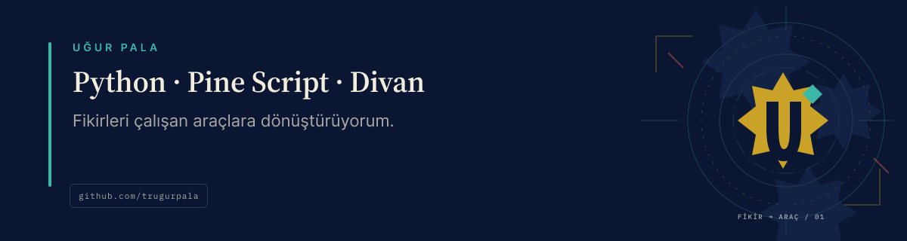

<a href="./README.md">Türkçe</a> · <strong>English</strong>

# Hi, I'm Uğur 👋

**I have an idea. I give it a try.**

I build useful tools for developers and everyday life. I choose the idea, build with Codex, check the result, and share the work as open source.

[Projects](#featured-projects) · [Guides](docs/README.md) · [Contributing](CONTRIBUTING.md) · [Contact](mailto:mail@ugurpala.com)

## Featured projects

| Project | What it does |
| --- | --- |
| [Divan](https://github.com/trugurpala/divan) | Planning, debugging, and verification workflows for Codex. [Install](https://github.com/trugurpala/divan#install) |
| [PALA Project Studio](https://github.com/trugurpala/pala-project-studio) | Local-first development and quality workflow. [First session](https://github.com/trugurpala/pala-project-studio/blob/main/docs/VIBE_FIRST_SESSION.md) |
| [Pine Script Agent Kit](https://github.com/trugurpala/pinescriptv6) | Source-linked Pine Script v6 guides and examples. |
| [Türkiye IBAN](https://github.com/trugurpala/turkiye-iban) | IBAN format/checksum validation and TCMB-backed institution codes. [PHP](https://github.com/trugurpala/turkiye-iban-php) · [Python](https://github.com/trugurpala/turkiye-iban-python) |
| [Ada Su](https://github.com/trugurpala/ada-su) | An ad-free water reminder that requires no account. [Try it](https://trugurpala.github.io/ada-su/) |

Pine Script results require separate TradingView verification. IBAN tools do not verify account existence or ownership.

## Open-source contribution

[Orca Turkish UI — merged PR #34718](https://github.com/stablyai/orca/pull/34718): In [my PR #31316](https://github.com/stablyai/orca/pull/31316), I refreshed the existing translation and tested the Windows interface. Orca shipped Turkish as a built-in language and credited me as a [co-author of the merge commit](https://github.com/stablyai/orca/commit/4b1967bdd83a47bef17293a4c4f9134d383cdb4a). This builds on earlier work by [@merttopuz](https://github.com/stablyai/orca/pull/22200) and [@mehmetefeaytas](https://github.com/merttopuz/orca/pull/1).

## Let's build useful things

For bugs or ideas, open an issue in the relevant project.

[Email](mailto:mail@ugurpala.com) · [X / @trugurpala](https://x.com/trugurpala)

---

[Contributing](CONTRIBUTING.md) · [Code of conduct](CODE_OF_CONDUCT.md) · [Security](SECURITY.md) · [MIT](LICENSE)
