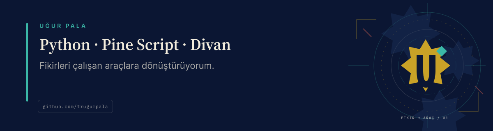

  <strong>Türkçe</strong> · <a href="./README.en.md">English</a>

# Merhaba, ben Uğur Pala

**Yapay zekâ destekli geliştirme · Yerel araçlar · Açık kaynak**

Günlük ihtiyaçları ve fikirleri, kodlama ajanlarıyla birlikte açık kaynak
projelere dönüştürüyorum. Kendimi bir *vibe coder* olarak tanımlıyorum:
ihtiyacı ve kapsamı belirliyor, küçük adımlarla geliştiriyor, ortaya çıkan
sonucu test edip belgeliyorum.

Burada kodlama ajanları için araçlarımı, Python ve Pine Script çalışmalarımı
ve açık kaynak katkılarımı bulabilirsiniz.

[E-posta](mailto:mail@ugurpala.com) · [X / @trugurpala](https://x.com/trugurpala)

## Öne çıkan projeler

### [Divan](https://github.com/trugurpala/divan)

Codex için doğal dille kullanılan bir mühendislik eklentisi. Depoyu inceleme,
planlama, hata ayıklama ve yapılan işi kanıtlarıyla doğrulama adımlarını
bir araya getirir.

[Kurulum ve kullanım →](https://github.com/trugurpala/divan#install)

### [Pala · Project Studio](https://github.com/trugurpala/pala-project-studio)

Bir fikirden veya mevcut depodan başlayarak planlama, geliştirme, kalite
kontrolü ve yayıma hazırlığı yöneten bir ortam. Proje durumu ve doğrulama
kanıtları varsayılan olarak yerelde tutulur; yapay zekâ sağlayıcıları
değiştirilebilir.

[İlk oturum rehberi →](https://github.com/trugurpala/pala-project-studio/blob/main/docs/VIBE_FIRST_SESSION.md)

### Diğer çalışmalarım

| Proje | Ne yapar? |
| --- | --- |
| [Pine Script Agent Kit](https://github.com/trugurpala/pinescriptv6) | Kodlama ajanları için kaynakları belirtilmiş Pine Script v6 rehberleri ve örnekleri. |
| [Türkiye IBAN](https://github.com/trugurpala/turkiye-iban) | Türkiye IBAN biçimi ve kontrol toplamı doğrulaması; TCMB kaynaklı kuruluş kodları ve açık veri. [TypeScript](https://github.com/trugurpala/turkiye-iban), [PHP](https://github.com/trugurpala/turkiye-iban-php) ve [Python](https://github.com/trugurpala/turkiye-iban-python) araçları. |
| [Ada Su](https://github.com/trugurpala/ada-su) | Hesap gerektirmeyen, reklamsız bir su hatırlatıcısı. Veriler tarayıcıda kalır; hatırlatmalar sayfa açıkken çalışır. [Deneyin →](https://trugurpala.github.io/ada-su/) |

Pine Script çıktıları TradingView üzerinde ayrıca doğrulanmalıdır.
IBAN araçları hesabın varlığını veya sahibini doğrulamaz.

## Açık kaynak katkım: Orca

**Türkçe yerelleştirme · Ekim 2026 · [PR #31316 — inceleme bekliyor](https://github.com/stablyai/orca/pull/31316)**

Mevcut Türkçe çeviriye 1.801 eksik girdi ekledim ve değişen metinleri
güncelledim. Türkçe kısayol aramasını ve yerel menü çevirilerini iyileştirdim.
Windows üzerinde arayüz ve regresyon kontrolleri yaptım; ekran görüntülerini,
test sonuçlarını ve bilinen sınırlamaları PR'da paylaştım.

Çalışma, [@merttopuz'un ilk çevirisi](https://github.com/stablyai/orca/pull/22200)
ve [@mehmetefeaytas'ın güncellemesi](https://github.com/merttopuz/orca/pull/1)
üzerine kurulu. OpenAI Codex desteğiyle hazırlandı; önceki katkıcıların
yazarlığı korundu. **PR henüz ana projeye birleştirilmedi.**

## Birlikte geliştirelim

Bir hata, fikir veya iyileştirme önerisi için ilgili projenin deposundan
ulaşabilirsiniz. Kodun yanında belgeler, çeviriler ve tekrarlanabilir hata
bildirimleri de değerli katkılar.

---

[Profile katkı](CONTRIBUTING.md) · [Topluluk kuralları](CODE_OF_CONDUCT.md) ·
[Güvenlik politikası](SECURITY.md) · [MIT Lisansı](LICENSE)
